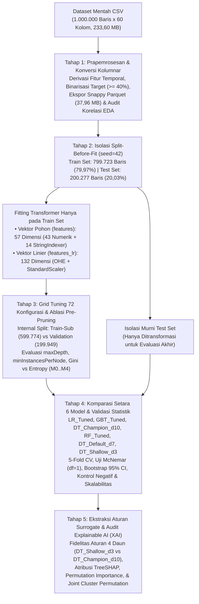
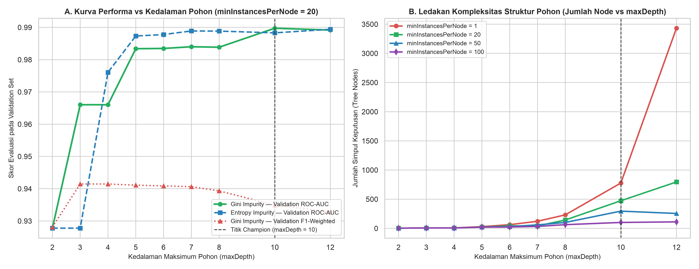
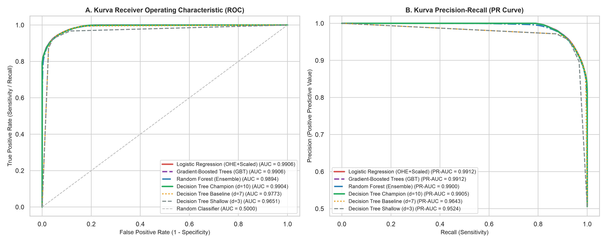
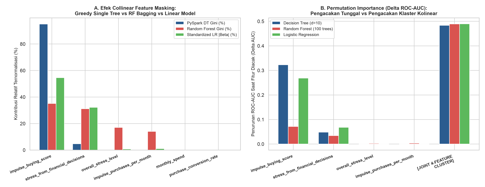
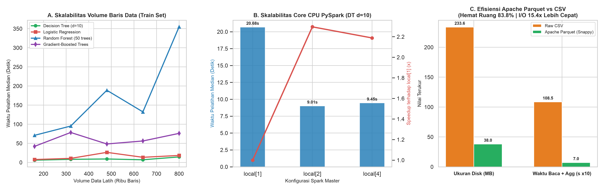

# Evaluasi Komparatif Model Klasifikasi dan Interpretabilitas Pohon Keputusan pada Apache Spark

**Galih [Nama Belakang]¹\*, Trias [Nama Belakang]², Risha [Nama Belakang]³, Raihan [Nama Belakang]⁴**  
¹˒²˒³˒⁴Program Studi [Nama Program Studi], Fakultas [Nama Fakultas], [Nama Universitas], [Kota], Indonesia  
Email: ¹[email.galih@domain.ac.id], ²[email.trias@domain.ac.id], ³[email.risha@domain.ac.id], ⁴[email.raihan@domain.ac.id]  
*\*Penulis Korespondensi*

---

## Abstrak

Pemrosesan klasifikasi pada data perilaku transaksi berskala jutaan baris menuntut keseimbangan antara efisiensi komputasi terdistribusi, ketepatan pemeringkatan probabilitas, dan transparansi aturan keputusan. Penelitian ini bertujuan mengevaluasi kinerja rekayasa pipeline *Apache Spark* (*PySpark*) serta membandingkan karakteristik *trade-off* antara algoritma klasifikasi linier, pohon keputusan tunggal (*Decision Tree*), dan ansambel pohon (*Random Forest* serta *Gradient-Boosted Trees*) pada dataset *benchmark* perilaku *e-commerce* berukuran 1.000.000 baris dan 60 atribut. Metodologi penelitian menerapkan transformasi penyimpanan kolumnar *Apache Parquet* berkompresi *Snappy*, protokol isolasi *Split-Before-Fit* (799.723 baris latih dan 200.277 baris uji), pencarian kisi 72 konfigurasi *pre-pruning* pada *validation split*, uji signifikansi berpasangan *McNemar*, selang kepercayaan *Bootstrap* 95%, uji kontrol negatif, serta audit *TreeSHAP* dan *Permutation Importance*. Hasil eksperimen membuktikan bahwa konversi *Snappy Parquet* memangkas ukuran penyimpanan sebesar 83,75% dan mempercepat pemindaian penuh hingga 15,39 kali. Pada data uji, *Logistic Regression* dan *Gradient-Boosted Trees* mencapai *ROC-AUC* tertinggi 0,9906 (akurasi 94,10%), namun *Decision Tree* teroptimasi (`maxDepth=10`, `minInstancesPerNode=20`, kriteria *Gini*) meraih *ROC-AUC* 0,9904 (akurasi 93,99%) dengan waktu pelatihan 14,42 detik serta mengungguli *Random Forest* (*ROC-AUC* 0,9894; 354,79 detik; $p = 0,0326$). Pohon *surrogate* empat daun (`maxDepth=3`) mampu mempertahankan 98,28% kesepakatan prediksi terhadap model utama, sementara audit *TreeSHAP* berhasil mengungkap fenomena *Greedy Collinear Feature Masking* pada empat prediktor psikologis yang berkorelasi kuat. Kerangka eksperimental ini menyediakan rujukan objektif bagi pemilihan model *white-box* pada sistem *Big Data* tabular.

**Kata Kunci**: *Apache Spark*; *Decision Tree*; Interpretabilitas Model; Klasifikasi Terdistribusi; *TreeSHAP*

---

## 1. Pendahuluan

Pertumbuhan volume pencatatan interaksi pengguna pada platform perdagangan elektronik (*e-commerce*) modern telah menggeser skala analisis data tabular dari ribuan baris menuju jutaan rekaman berdimensi puluhan atribut. Pada skala satu juta baris dengan kombinasi atribut numerik dan kategorikal yang heterogen, pengolahan data menggunakan pustaka pemrosesan *single-node* konvensional yang bergantung pada memori lokal tunggal sering mengalami kemacetan masukan-keluaran (*input-output bottleneck*) hingga kegagalan alokasi memori (*out-of-memory*) saat menjalankan transformasi fitur maupun validasi silang berulang [1], [2]. Selain beban komputasi pada tahap pelatihan model, format penyimpanan berbasis baris (*row-oriented text*) seperti *Comma-Separated Values* (CSV) memaksa mesin pemroses melakukan pemindaian tabel secara menyeluruh (*full table scan*) setiap kali operasi agregasi atau proyeksi subset kolom dijalankan [1]. Untuk mengatasi hambatan arsitektural tersebut, kerangka kerja komputasi terdistribusi *in-memory* *Apache Spark* melalui antarmuka *PySpark* dan pustaka *Spark MLlib* memungkinkan partisi data dieksekusi secara paralel di memori lintas unit pemroses, terutama ketika dipadukan dengan format penyimpanan kolumnar *Apache Parquet* yang mendukung pemangkasan kolom (*columnar projection*) serta kompresi blok [1], [2], [3]. Meskipun keunggulan infrastruktur *Apache Spark* telah banyak dibuktikan pada pemrosesan kueri basis data grafik [1], peramalan beban energi ratusan juta baris [2], dan pengelompokan data campuran [3], evaluasi sistematis yang memadukan efisiensi penyimpanan kolumnar dengan protokol rekayasa fitur bebas kebocoran (*zero-leakage feature engineering*) serta audit lintas algoritma klasifikasi pada skala jutaan baris masih jarang didokumentasikan secara utuh sebagai rujukan metodologis.

Dalam ranah pemodelan klasifikasi pada data perilaku transaksi seperti prediksi pembatalan keranjang belanja (*shopping cart abandonment*) [13], peneliti dan praktisi rekayasa sistem sering dihadapkan pada dilema pemilihan keluarga algoritma antara model linier terkalibrasi, pohon keputusan tunggal (*Decision Tree*), dan model ansambel berbasis *bagging* (*Random Forest*) maupun *boosting* (*Gradient-Boosted Trees* atau *XGBoost*) [8], [10], [11]. Secara teoretis, algoritma *Decision Tree* dan *Random Forest* memiliki sifat konsistensi kuat universal (*universal strong consistency*) yang menjamin konvergensi kesalahan klasifikasi menuju batas risiko Bayes optimal ($L^*$) seiring bertambahnya ukuran sampel $n \to \infty$, dengan syarat ukuran sampel minimum pada setiap simpul daun ($k_n$) tumbuh memenuhi $k_n / \log n \to \infty$ dan $k_n / n \to 0$ [4]. Akan tetapi, pada praktik empiris, pohon keputusan tunggal yang dibangun tanpa pembatasan kedalaman (`maxDepth`) dan tanpa ambang sampel daun minimum (`minInstancesPerNode`) sangat rentan membentuk percabangan berlebih yang menghafal derau (*noise*) serta pencilan pada data latih, sehingga menurunkan kemampuan generalisasi pada data uji [5], [6], [17]. Sebaliknya, penerapan regulasi *pre-pruning* melalui pembatasan kedalaman pohon dan ukuran minimum simpul daun terbukti mampu memangkas kompleksitas struktur pohon hingga 60% sembari mempertahankan akurasi klasifikasi dan menghasilkan aturan keputusan eksplisit berbentuk *IF-THEN* dari akar ke daun [6], [7].

Di sisi lain, anggapan umum bahwa algoritma ansambel kompleks seperti *Random Forest* dan *Gradient Boosting* selalu mengungguli model yang lebih sederhana tidak selalu berlaku mutlak pada setiap struktur distribusi data [8], [10], [14]. Ketika struktur hubungan antar-fitur telah terwakili dengan baik melalui pengodean *One-Hot Encoding* dan penyekalaan fitur numerik, model *Logistic Regression* biner terbukti mampu menyamai bahkan secara statistik melampaui *Random Forest* dan *XGBoost* pada metrik *Area Under the Receiver Operating Characteristic Curve* (*ROC-AUC*) dengan waktu pelatihan yang jauh lebih singkat [8], [9], [14]. Lebih jauh lagi, pada ruang berdimensi puluhan fitur di mana sinyal prediktif sejati hanya terkonsentrasi pada segelintir variabel utama sementara mayoritas atribut lainnya bersifat derau independen [18], mekanisme pencuplikan sub-ruang fitur acak sebesar $\lfloor\sqrt{D}\rfloor$ pada setiap simpul *Random Forest* [4] justru berisiko membangun sebagian pohon dari himpunan fitur berkualitas rendah. Kondisi tersebut membuka kemungkinan menarik secara algoritmik, yakni sebuah pohon keputusan tunggal yang dioptimalkan melalui *pre-pruning* tidak hanya berlatih puluhan kali lebih cepat [5], tetapi juga berpotensi mengungguli *Random Forest* pada akurasi maupun pemeringkatan probabilitas [5], [10].

Di luar persoalan perbandingan akurasi dan waktu komputasi, terdapat tiga celah metodologis yang kerap mengaburkan validitas eksperimen klasifikasi pada dataset publik berskala besar. Pertama, penerapan transformasi statistik global — seperti pengindeksan kategori (*StringIndexer*), pengodean biner (*OneHotEncoder*), penyekalaan deviasi standar (*StandardScaler*), maupun penyeimbangan kelas — yang dijalankan pada keseluruhan dataset sebelum pemisahan data latih dan data uji (*fit-before-split*) dapat memicu kebocoran informasi (*data leakage*) yang menggelembungkan metrik evaluasi secara semu [15]. Kedua, pada dataset berukuran ratusan ribu hingga jutaan baris, selisih metrik kinerja di tingkat desimal ketiga atau keempat sering kali langsung diklaim sebagai keunggulan algoritma tanpa disertai uji signifikansi statistik berpasangan seperti uji *McNemar* [12] maupun estimasi ukuran efek (*effect size*) melalui selang kepercayaan *Bootstrap*. Ketiga, evaluasi interpretabilitas pada model berbasis pohon sering kali hanya mengandalkan metrik reduksi ketidakmurnian internal (*Gini importance*) [2], [17]. Padahal, ketika dataset mengandung klaster fitur yang saling berkorelasi linier sangat kuat (*multicollinearity*) [2], [9], algoritma pemisahan pohon yang bersifat rakus (*greedy*) akan menyerap hampir seluruh penurunan ketidakmurnian pada fitur pertama yang terpilih di simpul akar dan menyembunyikan kontribusi fitur-fitur kolinear pendampingnya (*Greedy Collinear Feature Masking*). Tanpa audit menggunakan metode *Explainable Artificial Intelligence* (XAI) berbasis teori permainan kooperatif seperti *SHapley Additive exPlanations* (*SHAP*) [15], [16], [17], [18] serta pengujian *Permutation Importance* gabungan, peneliti berisiko menarik kesimpulan yang keliru mengenai faktor pendorong keputusan model.

Bertolak dari permasalahan tersebut, penelitian ini merancang dan mengeksekusi kerangka kerja evaluasi komparatif algoritma klasifikasi terdistribusi pada *Apache Spark* (*PySpark*) menggunakan dataset *benchmark* statis perilaku pembelanja *e-commerce* berskala 1.000.000 baris dan 60 kolom. Mengingat karakteristik dataset publik tersebut merupakan data kurasi statis yang merepresentasikan distribusi pembangkitan sintetis [17], fokus utama penelitian ini diletakkan sepenuhnya pada rekayasa proses pemodelan, validasi bebas kebocoran, dan pembedahan perilaku algoritmik — bukan pada klaim kausalitas psikologi konsumen di dunia nyata [13], [17]. Secara spesifik, kontribusi penelitian ini mencakup: (1) kuantifikasi efisiensi penyimpanan dan kecepatan pemindaian format kolumnar *Snappy Parquet* dibanding CSV pada pipeline *Split-Before-Fit* berdimensi ganda (57 fitur indeks pohon dan 132 dimensi *One-Hot Encoded* terstandarisasi); (2) analisis ablasi *pre-pruning* 72 konfigurasi (`maxDepth`, `minInstancesPerNode`, serta kriteria *Gini* lawan *Entropy*) terhadap gejala *node explosion*; (3) evaluasi komparatif enam model (*Logistic Regression*, *Gradient-Boosted Trees*, *Random Forest*, dan tiga kedalaman *Decision Tree*) menggunakan validasi silang 5-*fold*, uji *McNemar*, *Bootstrap* 95% *Confidence Interval*, uji kontrol negatif, serta uji sensitivitas ambang target; dan (4) pembuktian fidelitas aturan *surrogate* empat daun (`maxDepth=3`) beserta resolusi bias *Greedy Collinear Feature Masking* melalui *TreeSHAP* dan *Joint Cluster Permutation*.

Sistematika penulisan naskah ini disusun ke dalam lima bagian utama. Bagian 2 menguraikan metode penelitian yang meliputi spesifikasi lingkungan komputasi *PySpark*, arsitektur prapemrosesan *Split-Before-Fit*, desain ablasi *hyperparameter*, protokol komparasi enam model, serta formulasi audit *TreeSHAP* dan *Permutation Importance*. Bagian 3 memaparkan hasil eksperimen secara objektif melalui tabel metrik kuantitatif, uji statistik, dan visualisasi kurva evaluasi. Bagian 4 menyajikan pembahasan kritis yang menafsirkan temuan empiris berdasarkan teori konsistensi Bayes, *trade-off* tiga sumbu, dinamika sub-ruang fitur *Random Forest*, dan efek multikolinearitas pada XAI. Terakhir, Bagian 5 merangkum kesimpulan penelitian dalam satu kesatuan sintesis.

---

## 2. Metode Penelitian

Penelitian ini menerapkan metode eksperimental kuantitatif pada lingkungan komputasi terdistribusi *Apache Spark* mode lokal (*PySpark Local Mode*). Seluruh tahapan eksperimen dirancang secara modular dan deterministik (`seed=42`) untuk menjamin ketertelusuran metrik serta mencegah kebocoran informasi dari data uji ke dalam proses pelatihan maupun pemilihan parameter model [15]. Secara menyeluruh, alur kerja metodologi penelitian dibagi ke dalam lima tahapan berurutan sebagaimana diilustrasikan pada **Gambar 1**.

**Gambar 1.** Arsitektur Pipeline Pemrosesan Terdistribusi *PySpark* dengan Protokol Isolasi *Split-Before-Fit* dan Evaluasi Multi-Model

### 2.1 Spesifikasi Lingkungan Komputasi dan Karakteristik Dataset Uji

Seluruh rangkaian pemrosesan data dan pelatihan model dijalankan menggunakan mesin *Apache Spark* versi 4.3.0 (*PySpark*) di atas *Java Virtual Machine* (OpenJDK 17.0.18) dengan konfigurasi sesi `spark.driver.memory=4g`, `spark.sql.shuffle.partitions=16`, serta eksekusi paralel memanfaatkan seluruh untai perangkat keras (`local[*]` pada prosesor 2 *physical cores* / 4 *logical threads*). Dataset yang digunakan sebagai objek pengujian adalah dataset publik *E-Commerce Shopper Behavior (Amazon/Shopify Based)* yang terdiri atas $N = 1.000.000$ baris observasi dan 60 kolom mentah dengan ukuran berkas CSV sebesar 233,60 MB. Pemeriksaan kelengkapan skema mengonfirmasi bahwa seluruh 60 kolom mentah tidak mengandung nilai kosong (*0 missing values*) maupun baris duplikat.

Untuk memisahkan secara tegas antara variabel prediktor independen, variabel target, dan variabel kontrol, dilakukan pemetaan skema sebagaimana dirangkum pada **Tabel 1**. Kolom penanda identitas unik (`user_id`) dibuang dari ruang fitur karena tidak memiliki makna generalisasi, sedangkan kolom tanggal transaksi terakhir (`last_purchase_date`) diekstraksi menjadi fitur numerik selisih hari terhadap tanggal acuan maksimum dataset (`2027-01-01`), menghasilkan variabel `days_since_last_purchase` (rentang 0 hingga 730 hari). Variabel kontinu `cart_abandonment_rate` (rentang $0,0\%$ hingga $90,0\%$, rata-rata $40,21\%$, simpangan baku $25,43\%$) ditransformasikan menjadi target klasifikasi biner `is_high_abandonment` menggunakan ambang batas tengah distribusi $\ge 40,0\%$ (`Kelas 1` sebanyak 505.469 baris atau $50,55\%$; `Kelas 0` sebanyak 494.531 baris atau $49,45\%$). Sementara itu, variabel `checkout_abandonments_per_month` (rentang 0 hingga 10) dipisahkan dari ke-57 prediktor dan disimpan sebagai target uji kontrol negatif (*negative control target* dengan ambang biner $\ge 5$) untuk memverifikasi ketiadaan kebocoran fitur pada pipeline.

**Tabel 1.** Ringkasan Skema Dataset, Kelompok Atribut, dan Partisi *Split-Before-Fit* ($N = 1.000.000$)

| Kelompok Skema / Partisi | Jumlah Kolom / Baris | Tipe Data Asli | Perlakuan pada Pipeline *PySpark* | Peran dalam Eksperimen |
| :--- | :---: | :--- | :--- | :--- |
| **Identitas Pengguna** (`user_id`) | 1 kolom | *String* / *Int* | Dieliminasi sebelum perakitan vektor | Penanda baris (bukan prediktor) |
| **Atribut Temporal Mentah** (`last_purchase_date`) | 1 kolom | *Date String* | Diderivasi menjadi `days_since_last_purchase` | Dikonversi ke fitur numerik |
| **Prediktor Numerik Independen** (`age`, `income_level`, `impulse_buying_score`, `stress_from_financial_decisions`, dll.) | 43 kolom | *Integer* / *Double* | Dirakit langsung (`features`) atau disekalakan dengan `StandardScaler` (`features_lr`) | Fitur input utama ($D_{\text{num}} = 43$) |
| **Prediktor Kategorikal Independen** (`country`, `gender`, `device_type`, `preferred_payment_method`, `product_category_preference`, dll.) | 14 kolom | *String* (3–10 kategori/kolom) | `StringIndexer` (`features` pohon) + `OneHotEncoder` (`features_lr` linier) | Fitur input utama ($D_{\text{cat}} = 14$) |
| **Target Utama** (`cart_abandonment_rate` $\rightarrow$ `is_high_abandonment`) | 1 kolom (+1 biner) | *Double* $\rightarrow$ *Int* $\{0,1\}$ | Binarisasi $\ge 40,0\%$ (uji sensitivitas pada $\ge 35,0\%$ dan $\ge 45,0\%$) | Label target klasifikasi ($50,55\%$ positif) |
| **Target Kontrol Negatif** (`checkout_abandonments_per_month`) | 1 kolom | *Integer* | Dikecualikan dari 57 prediktor; dibinerkan ($\ge 5$) khusus saat audit kebocoran | Bukti empiris nol *data leakage* |
| **Partisi Data Latih (*Full Train Set*)** | 799.723 baris ($79,97\%$) | *Snappy Parquet* | Dibagi internal: *Train-Sub* (599.774 baris) & *Validation* (199.949 baris) | Pencarian *hyperparameter* & pelatihan model |
| **Partisi Data Uji (*Held-Out Test Set*)** | 200.277 baris ($20,03\%$) | *Snappy Parquet* | Diisolasi penuh; hanya dievaluasi satu kali pada pengujian akhir | Evaluasi objektif lintas model |

### 2.2 Penyimpanan Kolumnar *Snappy Parquet* dan Protokol *Split-Before-Fit*

Pada Tahap 1 (**Gambar 1**), tabel yang telah melalui derivasi fitur temporal dan pelabelan target disimpan ke dalam format kolumnar *Apache Parquet* dengan algoritma kompresi blok *Snappy* [1]. Untuk mengukur dampak arsitektur penyimpanan terhadap kinerja masukan-keluaran (*I/O*), dilakukan pengujian waktu baca dan agregasi penuh antara berkas CSV mentah dan berkas *Snappy Parquet* pada kondisi *cold/warm read* di *PySpark*, disertai pemindaian korelasi bivariat Pearson ($r$) antara seluruh fitur numerik terhadap target [2], [9].

Selanjutnya pada Tahap 2, untuk mencegah kebocoran statistik distribusi global ke dalam data uji [15], dataset dibagi terlebih dahulu menggunakan pemisahan acak terkontrol (`randomSplit([0.8, 0.2], seed=42)`) menjadi *Train Set* ($799.723$ baris; $79,97\%$) dan *Test Set* ($200.277$ baris; $20,03\%$). Seluruh estimator transformasi fitur di dalam `pyspark.ml.Pipeline` hanya di-*fit* pada *Train Set* (`pipeline.fit(train_df)`), kemudian model transformasi yang dihasilkan diterapkan secara searah pada *Train Set* dan *Test Set*. Mengingat perbedaan karakteristik matematis antara algoritma berbasis pohon keputusan dan model linier [2], [8], pipeline membangun dua representasi vektor fitur secara simultan dari ke-57 prediktor yang sama:
1. **Vektor Fitur Model Pohon (`features`, 57 dimensi)**: Menggabungkan 43 kolom numerik asli dan 14 kolom kategorikal yang telah dipetakan menjadi indeks bilangan bulat terurut berdasarkan frekuensi melalui `StringIndexer(handleInvalid="keep")` menggunakan `VectorAssembler`. Algoritma pohon di *Spark MLlib* mampu mengevaluasi pemisahan subset kategori dan ambang numerik secara langsung tanpa memerlukan penyekalaan varians [2].
2. **Vektor Fitur Model Linier (`features_lr`, 132 dimensi)**: Mengodekan ke-14 kolom indeks kategorikal menjadi vektor biner menggunakan `OneHotEncoder(dropLast=True, handleInvalid="keep")` (menghasilkan 89 dimensi biner dari total kardinalitas kategori beserta slot kategori tak dikenal), menggabungkannya dengan 43 kolom numerik menjadi 132 dimensi, lalu menstandarkan deviasi standar setiap dimensi menggunakan `StandardScaler(withMean=False, withStd=True)` agar matriks fitur tetap jarang (*sparse-friendly*) di memori *PySpark* dan bobot regresi berada pada skala yang setara [2], [8].

### 2.3 Pencarian Kisi 72 Konfigurasi dan Skenario Ablasi *Pre-Pruning*

Pada Tahap 3, guna menghindari bias pemilihan parameter pada data uji (*test-set overfitting*), *Train Set* ($799.723$ baris) dibagi kembali secara internal dengan rasio $75:25$ (`seed=42`) menjadi *Train-Sub* ($599.774$ baris) dan *Validation Split* ($199.949$ baris). Sebanyak $9 \times 4 \times 2 = 72$ kombinasi konfigurasi *Decision Tree Classifier* dievaluasi secara sistematis melintasi tiga dimensi *hyperparameter* utama [5], [7], [12]:
- Kedalaman maksimum pohon (`maxDepth`): $\{2, 3, 4, 5, 6, 7, 8, 10, 12\}$;
- Jumlah sampel minimum per simpul daun (`minInstancesPerNode`): $\{1, 20, 50, 100\}$;
- Fungsi ketidakmurnian pemisahan simpul (`impurity`): kriteria *Gini* ($G = 1 - \sum_{c=1}^{C} p_c^2$) dan *Entropy* ($H = -\sum_{c=1}^{C} p_c \log_2 p_c$) [12], [16].

Selain pemindaian kisi penuh pada *Validation Split*, disusun delapan skenario ablasi terkontrol (`M0`, `Baseline_d5`, `M1`, `M2`, `M3a`, `M3b`, `M3c`, dan `M4`) yang dilatih ulang pada 100% *Train Set* ($799.723$ baris) untuk mengisolasi pengaruh murni setiap parameter satu per satu (*one-factor-at-a-time controlled ablation*): (1) pengaruh peningkatan kedalaman pohon dari dangkal ke dalam (`M0` pada `maxDepth=3`, `Baseline_d5` pada `maxDepth=5`, `M1` pada `maxDepth=7`, dan `M2` pada `maxDepth=10` dengan `minInstancesPerNode=20, gini`); (2) pengaruh murni *pre-pruning* ukuran daun (`M2` dengan `minInstancesPerNode=20` lawan `M3a` dengan `minInstancesPerNode=50` pada `maxDepth=10, gini`); (3) pengaruh murni kriteria ketidakmurnian (`M2` dengan `gini` lawan `M3b` dengan `entropy` pada `maxDepth=10, minInstancesPerNode=20`, serta `M3c` pada `entropy, minInstancesPerNode=50`); dan (4) dampak penghapusan *pre-pruning* pada pohon dalam (`M4` dengan `maxDepth=12, minInstancesPerNode=1, gini`).

### 2.4 Skenario Komparasi Enam Model, Uji Statistik *McNemar*, dan Uji Kekokohan

Pada Tahap 4, enam model klasifikasi yang mewakili tiga paradigma pembelajaran mesin (linier, pohon tunggal berbagai tingkat kompleksitas, dan ansambel pohon *bagging*/*boosting*) dilatih pada *Full Train Set* ($799.723$ baris) dan diuji pada *Held-Out Test Set* ($200.277$ baris) [8], [10], [11]:
1. **`LR_Tuned`**: *Logistic Regression* pada vektor `features_lr` (132 dimensi) dengan hasil pemilihan kisi validasi terbaik `regParam=0.0, elasticNetParam=0.0, maxIter=50`.
2. **`GBT_Tuned`**: *Gradient-Boosted Trees Classifier* pada vektor `features` (57 dimensi) dengan konfigurasi validasi terbaik `maxIter=20, maxDepth=5, stepSize=0.1, minInstancesPerNode=20`.
3. **`DT_Champion_d10`**: Pohon keputusan tunggal optimal hasil *tuning* validasi (`maxDepth=10, minInstancesPerNode=20, impurity='gini'`).
4. **`RF_Tuned`**: *Random Forest Classifier* dengan konfigurasi validasi terbaik `numTrees=40, maxDepth=10, minInstancesPerNode=20, featureSubsetStrategy='sqrt', impurity='gini'` [4].
5. **`DT_Default_d7`**: Pohon keputusan tingkat menengah (`maxDepth=7, minInstancesPerNode=20, impurity='gini'`).
6. **`DT_Shallow_d3`**: Pohon keputusan ringkas (`maxDepth=3, minInstancesPerNode=20, impurity='gini'`) yang berfungsi sebagai model aturan *surrogate* yang dapat dibaca manusia secara utuh.

Guna memastikan evaluasi tidak bias pada satu metrik tunggal, kinerja keenam model diukur menggunakan *ROC-AUC*, *Area Under the Precision-Recall Curve* (*PR-AUC*), Akurasi, *F1-Score* terboboti (*F1-Weighted*), *Precision*, *Recall*, kompleksitas struktur (jumlah pohon dan total simpul/node), waktu pelatihan, serta rata-rata dan simpangan baku *5-Fold Cross-Validation ROC-AUC*. Untuk menguji apakah perbedaan ketepatan klasifikasi antara dua model ($A$ dan $B$) pada $N = 200.277$ sampel uji yang sama bersifat signifikan secara statistik, diterapkan uji khi-kuadrat *McNemar* berpasangan dengan koreksi kontinuitas ($\text{df} = 1$) [12]:

$$\chi^2_{\text{McNemar}} = \frac{(|b - c| - 1)^2}{b + c}$$

di mana $b$ menyatakan jumlah sampel uji yang diklasifikasikan dengan benar oleh model $A$ tetapi salah oleh model $B$, sedangkan $c$ menyatakan jumlah sampel uji yang salah pada model $A$ tetapi benar pada model $B$. Mengingat ukuran sampel yang sangat besar ($N > 200.000$) dapat menghasilkan *p-value* yang sangat kecil meskipun selisih kinerjanya sempit, pengujian dilengkapi dengan estimasi selang kepercayaan *Bootstrap* 95% ($B = 300$ pencuplikan ulang berpasangan dengan pengembalian pada subsampel $40.000$ baris uji) atas selisih $\Delta\text{ROC-AUC} = \text{AUC}_A - \text{AUC}_B$. Selain itu, dilakukan tiga pengujian kekokohan tambahan: (1) uji sensitivitas pergeseran ambang binarisasi target pada `cart_abandonment_rate` $\ge 35,0\%$ dan $\ge 45,0\%$; (2) uji kontrol negatif menggunakan target independen `checkout_abandonments_per_month >= 5`; serta (3) uji skalabilitas komputasi *PySpark* terhadap peningkatan fraksi baris data latih ($20\%, 40\%, 60\%, 80\%, 100\%$) dan variasi jumlah untai eksekutor (`local[1]`, `local[2]`, `local[4]`).

### 2.5 Ekstraksi Aturan *Surrogate*, *TreeSHAP*, dan *Permutation Importance*

Pada Tahap 5, struktur percabangan model *white-box* diekstraksi dan dipetakan kembali dari indeks fitur internal (`feature 0..56`) ke nama atribut asli beserta label kategorinya. Tingkat fidelitas (*surrogate fidelity*) antara pohon ringkas `DT_Shallow_d3` (4 simpul daun) dan model utama `DT_Champion_d10` (473 simpul) dihitung sebagai proporsi kesepakatan kelas prediksi pada seluruh data uji:

$$\text{Fidelity}(M_{\text{shallow}}, M_{\text{champion}}) = \frac{1}{N_{\text{test}}} \sum_{i=1}^{N_{\text{test}}} \mathbb{I}\!\left(\hat{y}_{i,\text{shallow}} = \hat{y}_{i,\text{champion}}\right)$$

Untuk membedah mekanisme atribusi fitur secara mendalam dan menguji hipotesis *Greedy Collinear Feature Masking*, dilakukan perbandingan empat metode atribusi: (1) reduksi ketidakmurnian *Gini* pada pohon tunggal `DT_Champion_d10`; (2) reduksi ketidakmurnian *Gini* rata-rata pada ansambel *Random Forest*; (3) nilai Shapley intervensi koalisi eksak (*TreeSHAP* / *Exact Coalition Shapley*) berbasis teori permainan Shapley [15], [16], [17], [18]; dan (4) *Permutation Feature Importance*. Mengacu pada pertimbangan efisiensi komputasi XAI pada dataset berukuran besar sebagaimana dikemukakan oleh Winanta dkk. [16], *Permutation Importance* dihitung pada subsampel acak data uji sebanyak $N_{\text{perm}} = 19.891$ baris ($\approx 10\%$ data uji) dengan mengukur penurunan $\Delta\text{ROC-AUC}$ ketika nilai suatu fitur diacak secara independen, ditambah eksperimen *Joint Collinear Cluster Permutation* yang mengacak keempat fitur psikologis kolinear secara serentak. Sementara itu, kontribusi marjinal aditif Shapley dihitung secara eksak atas seluruh $2^4 = 16$ koalisi fitur utama pada subsampel representatif $N_{\text{shap}} = 1.500$ baris uji (dengan $500$ baris latih sebagai distribusi latar belakang) sesuai persamaan Shapley [16], [18]:

$$\phi_j(f, x) = \sum_{S \subseteq F \setminus \{j\}} \frac{|S|!\,(|F| - |S| - 1)!}{|F|!} \left[ f_{S \cup \{j\}}(x_{S \cup \{j\}}) - f_S(x_S) \right]$$

di mana $F$ adalah himpunan seluruh 57 fitur prediktor, $S$ adalah himpunan bagian fitur tanpa fitur ke-$j$, dan $\phi_j(f, x)$ menyatakan kontribusi aditif fitur ke-$j$ terhadap pergeseran log-odds atau probabilitas prediksi dari nilai harapan dasar $E[f(x)]$ [15], [16], [18].

---

## 3. Hasil Penelitian

### 3.1 Efisiensi Penyimpanan Kolumnar *Snappy Parquet* dan Distribusi Korelasi Fitur

Transformasi dataset mentah dari format baris CSV ($233,60\text{ MB}$) ke dalam format kolumnar *Apache Parquet* berkompresi *Snappy* menurunkan ukuran penyimpanan di disk menjadi $37,96\text{ MB}$, yang setara dengan rasio penghematan ruang sebesar $83,75\%$ (faktor kompresi $6,15\times$). Pada pengujian waktu baca dan agregasi statistik penuh di *PySpark* atas $1.000.000$ baris dan 60 kolom, pemindaian berkas CSV membutuhkan waktu rata-rata $10,847\text{ detik}$, sedangkan pemindaian berkas *Snappy Parquet* diselesaikan dalam $0,705\text{ detik}$ (percepatan waktu baca dan kueri sebesar $15,39\times$).

Hasil audit korelasi bivariat Pearson ($r$) antara ke-43 prediktor numerik terhadap variabel target `cart_abandonment_rate` menunjukkan struktur distribusi yang terpolarisasi secara tajam. Empat variabel psikologis dan perilaku impulsif menunjukkan korelasi linier positif yang sangat tinggi terhadap tingkat pembatalan keranjang, sekaligus saling berkorelasi kuat satu sama lain: `impulse_buying_score` ($r = +0,9615$), `stress_from_financial_decisions` ($r = +0,9404$), `overall_stress_level` ($r = +0,8635$), dan `impulse_purchases_per_month` ($r = +0,8501$). Sebaliknya, 39 fitur numerik lainnya — termasuk `age` ($r = +0,0002$), `income_level` ($r = +0,0010$), `monthly_spend` ($r = +0,0010$), `average_order_value` ($r = -0,0008$), `cart_items_average` ($r = +0,0002$), `days_since_last_purchase` ($r = -0,0005$), serta variabel kontrol negatif `checkout_abandonments_per_month` ($r = -0,0009$) — berada di dalam rentang korelasi $|r| \le 0,0021$. Demikian pula, ke-14 fitur kategorikal (`country`, `gender`, `device_type`, `preferred_payment_method`, `product_category_preference`, dan lainnya) memiliki proporsi kelas positif yang seragam di kisaran $50,3\%$ hingga $50,8\%$ lintas kategori.

### 3.2 Hasil Pencarian Kisi 72 Konfigurasi dan Ablasi *Pre-Pruning* Pohon Keputusan

Pemindaian 72 konfigurasi *hyperparameter* pada *Validation Split* ($199.949$ baris) yang divisualisasikan pada **Gambar 2** (`reports/dt_pruning_depth_curve.png`) menunjukkan bahwa peningkatan `maxDepth` dari 3 hingga 10 secara konsisten meningkatkan nilai *Validation ROC-AUC* ketika ukuran simpul daun minimum dibatasi pada `minInstancesPerNode` $\ge 20$, dengan capaian tertinggi pada `M2_Champion_d10_gini20` (`maxDepth=10, minInstancesPerNode=20, gini` dengan *Validation ROC-AUC* $0,9897$ dan *Validation PR-AUC* $0,9899$). Akan tetapi, pada konfigurasi tanpa *pre-pruning* (`minInstancesPerNode=1`), kurva *Validation ROC-AUC* mencapai puncaknya pada `maxDepth=10` ($0,9866$) lalu mengalami penurunan tajam menjadi $0,9752$ pada `maxDepth=12` akibat pembengkakan jumlah simpul pohon.

  
**Gambar 2.** Kurva Validasi 72 Konfigurasi: Pengaruh `maxDepth`, `minInstancesPerNode`, dan Kriteria *Impurity* terhadap *ROC-AUC* serta Jumlah Simpul (*Node*)

Hasil evaluasi delapan konfigurasi ablasi terkontrol (`M0` hingga `M4`) setelah dilatih ulang pada *Full Train Set* ($799.723$ baris) dan diuji pada *Held-Out Test Set* ($200.277$ baris) disajikan pada **Tabel 2**. Pada kelompok peningkatan kedalaman dengan `minInstancesPerNode=20` dan kriteria `gini`, perluasan struktur pohon dari `M0_Shallow_d3` (`maxDepth=3`, 7 simpul) ke `M1_Baseline_d7` (`maxDepth=7`, 41 simpul) dan `M2_Champion_d10_gini20` (`maxDepth=10`, 473 simpul) menaikkan *Validation ROC-AUC* dari $0,9660$ menjadi $0,9840$ hingga $0,9897$, serta menaikkan *Test ROC-AUC* dari $0,9651$ menjadi $0,9773$ dan mencapai nilai tertinggi $0,9904$ (*Test PR-AUC* $0,9905$; Akurasi $93,99\%$; waktu latih $14,42\text{ detik}$).

**Tabel 2.** Hasil Ablasi Parameter *Pre-Pruning* dan Kriteria *Impurity* pada *Decision Tree* ($N_{\text{train}} = 799.723$; $N_{\text{test}} = 200.277$)

| ID Konfigurasi Model | `maxDepth` | `minInst` | Kriteria *Impurity* | Jumlah Simpul (*Node*) | *Val ROC-AUC* ($199.949$) | *Test ROC-AUC* ($200.277$) | *Test PR-AUC* | *Test Akurasi* (%) | *Test F1-Weighted* | Waktu Latih (s) |
| :--- | :---: | :---: | :---: | :---: | :---: | :---: | :---: | :---: | :---: | :---: |
| **`M0_Shallow_d3`** | 3 | 20 | `gini` | 7 | 0,9660 | 0,9651 | 0,9524 | 94,06 | 0,9406 | 8,80 |
| **`DT_Baseline_d5`** | 5 | 20 | `gini` | 11 | — | 0,9318 | 0,9447 | 94,09 | 0,9409 | 12,18 |
| **`M1_Baseline_d7`** | 7 | 20 | `gini` | 41 | 0,9840 | 0,9773 | 0,9643 | 94,09 | 0,9409 | 8,34 |
| **`M2_Champion_d10_gini20`** | **10** | **20** | **`gini`** | **473** | **0,9897** | **0,9904** | **0,9905** | **93,99** | **0,9399** | **14,42** |
| **`M3a_d10_gini50`** *(Ablasi `minInst`)* | 10 | 50 | `gini` | 295 | 0,9884 | 0,9835 | 0,9779 | 94,00 | 0,9400 | 10,07 |
| **`M3b_d10_entropy20`** *(Ablasi `Impurity`)* | 10 | 20 | `entropy` | 227 | 0,9883 | 0,9883 | 0,9887 | 94,03 | 0,9403 | 9,17 |
| **`M3c_d10_entropy50`** *(Kombinasi)* | 10 | 50 | `entropy` | 161 | 0,9885 | 0,9883 | 0,9883 | 94,04 | 0,9404 | 10,72 |
| **`M4_Deep_d12_gini1`** *(Tanpa Pruning)* | 12 | 1 | `gini` | 3.431 | 0,9752 | 0,9871 | 0,9863 | 93,67 | 0,9367 | 18,64 |

Pada pengujian ablasi murni `minInstancesPerNode` pada `maxDepth=10` dan kriteria `gini` (`M2` lawan `M3a`), peningkatan batas minimum sampel daun dari 20 menjadi 50 memangkas jumlah simpul sebesar $37,63\%$ (dari 473 menjadi 295 simpul) dengan perubahan *Validation ROC-AUC* dari $0,9897$ ke $0,9884$, perubahan *Test ROC-AUC* dari $0,9904$ ke $0,9835$, dan akurasi stabil pada $94,00\%$. Pada ablasi murni kriteria ketidakmurnian pada `maxDepth=10` dan `minInstancesPerNode=20` (`M2` lawan `M3b`), kriteria `gini` menghasilkan *Validation ROC-AUC* $0,9897$, *Test ROC-AUC* $0,9904$, dan *Test PR-AUC* $0,9905$ (473 simpul), sedangkan kriteria `entropy` menghasilkan *Validation ROC-AUC* $0,9883$, *Test ROC-AUC* $0,9883$, dan *Test PR-AUC* $0,9887$ dengan struktur pohon yang lebih ringkas (227 simpul). Sebaliknya, pada konfigurasi `M4_Deep_d12_gini1` (`maxDepth=12, minInstancesPerNode=1`), jumlah simpul membengkak $7,25\times$ lipat menjadi $3.431$ simpul (atau berkurang $86,21\%$ ketika dipangkas ke `M2`), diikuti penurunan *Validation ROC-AUC* ke $0,9752$, penurunan *Test ROC-AUC* ke $0,9871$, dan penurunan akurasi uji ke titik terendah $93,67\%$.

### 3.3 Perbandingan Kinerja Enam Model Klasifikasi dan Uji Statistik *McNemar*

Hasil evaluasi komparatif keenam model pada *Held-Out Test Set* ($N = 200.277$) beserta validasi silang 5-*fold* disajikan pada **Tabel 3**, sedangkan perbandingan visual kurva *ROC* dan *Precision-Recall* ditampilkan pada **Gambar 3** (`reports/model_roc_pr_curves.png`). Model linier `LR_Tuned` (132 bobot kontinu) dan model ansambel *boosting* `GBT_Tuned` (20 pohon; 958 simpul) mencatatkan *Test ROC-AUC* tertinggi sebesar $0,9906$, *Test PR-AUC* $0,9912$, dan akurasi uji $94,10\%$, dengan rata-rata *5-Fold CV ROC-AUC* masing-masing sebesar $0,9905 \pm 0,0004$. Model pohon keputusan tunggal `DT_Champion_d10` (1 pohon; 473 simpul) menempati peringkat berikutnya dengan *Test ROC-AUC* $0,9904$ (*95% CI* $[0,9900, 0,9910]$), *Test PR-AUC* $0,9905$, akurasi uji $93,99\%$, *Precision* kelas positif $94,27\%$, *Recall* kelas positif $93,82\%$, dan waktu pelatihan $14,42\text{ detik}$.

**Tabel 3.** Perbandingan Kinerja Prediktif, Kompleksitas Struktur, Matriks Konfusi, dan Waktu Pelatihan Enam Model pada Data Uji ($N = 200.277$)

| Model | Kompleksitas Struktur | *5-Fold CV ROC-AUC* | *Test ROC-AUC* (*Bootstrap 95% CI*) | *Test PR-AUC* | Akurasi Uji (%) | *F1-Weighted* | *TN* / *FP* / *FN* / *TP* | Waktu Latih (s) |
| :--- | :--- | :---: | :---: | :---: | :---: | :---: | :---: | :---: |
| **`LR_Tuned`** | 132 bobot linier | $0,9905 \pm 0,0004$ | **0,9906** ($[0,9902, 0,9912]$) | **0,9912** | **94,10** | **0,9410** | 92.702 / 6.221 / 5.604 / 95.750 | 18,26 |
| **`GBT_Tuned`** | 20 pohon (958 simpul) | $0,9905 \pm 0,0004$ | **0,9906** ($[0,9901, 0,9912]$) | **0,9912** | **94,10** | 0,9409 | 92.692 / 6.231 / 5.595 / 95.759 | 76,01 |
| **`DT_Champion_d10`** | **1 pohon (473 simpul)** | $0,9883 \pm 0,0005$ | **0,9904** ($[0,9900, 0,9910]$) | **0,9905** | 93,99 | 0,9399 | 93.146 / 5.777 / 6.264 / 95.090 | **14,42** |
| **`RF_Tuned`** | 40 pohon (24.944 simpul) | $0,9894 \pm 0,0005$ | 0,9894 ($[0,9888, 0,9900]$) | 0,9900 | 93,92 | 0,9392 | 92.361 / 6.562 / 5.611 / 95.743 | 354,79 |
| **`DT_Default_d7`** | 1 pohon (41 simpul) | $0,9793 \pm 0,0043$ | 0,9773 ($[0,9763, 0,9782]$) | 0,9643 | 94,09 | 0,9409 | 92.881 / 6.042 / 5.789 / 95.565 | 8,34 |
| **`DT_Shallow_d3`** | **1 pohon (7 simpul / 4 daun)** | $0,9688 \pm 0,0064$ | 0,9651 ($[0,9639, 0,9664]$) | 0,9524 | 94,06 | 0,9406 | 94.484 / 4.439 / 7.452 / 93.902 | 8,80 |

Model ansambel *bagging* `RF_Tuned` (40 pohon; total $24.944$ simpul) memperoleh *Test ROC-AUC* sebesar $0,9894$ (*95% CI* $[0,9888, 0,9900]$), *Test PR-AUC* $0,9900$, dan akurasi uji $93,92\%$ dengan waktu pelatihan paling lama yakni $354,79\text{ detik}$ ($24,60\times$ lebih lambat dibanding `DT_Champion_d10`). Sementara itu, model pohon menengah `DT_Default_d7` (41 simpul; waktu latih $8,34\text{ detik}$) dan pohon dangkal `DT_Shallow_d3` (7 simpul / 4 daun; waktu latih $8,80\text{ detik}$) mencatat akurasi titik masing-masing sebesar $94,09\%$ dan $94,06\%$, namun menghasilkan *Test ROC-AUC* yang lebih rendah yakni $0,9773$ dan $0,9651$ karena jumlah nilai probabilitas diskrit yang dihasilkan lebih sedikit.

  
**Gambar 3.** Kurva *ROC* dan *Precision-Recall* Komparatif Enam Model Klasifikasi pada Data Uji ($N = 200.277$)

Hasil pengujian signifikansi statistik berpasangan *McNemar* ($\text{df} = 1$) dan estimasi selang kepercayaan *Bootstrap* 95% atas selisih $\Delta\text{ROC-AUC}$ terhadap model acuan `DT_Champion_d10` dipaparkan pada **Tabel 4**. Perbandingan antara `LR_Tuned` dan `DT_Champion_d10` menghasilkan jumlah sampel diskordan $b = 1.202$ dan $c = 986$ dengan nilai statistik $\chi^2_{\text{McNemar}} = 21,13$ ($p = 4,23 \times 10^{-6}$) dan selisih $\Delta\text{ROC-AUC} = +0,00024$ (*95% CI* $[+0,00013, +0,00037]$). Perbandingan antara `GBT_Tuned` dan `DT_Champion_d10` menghasilkan $b = 1.200$ dan $c = 985$ dengan $\chi^2_{\text{McNemar}} = 20,96$ ($p = 4,61 \times 10^{-6}$) dan $\Delta\text{ROC-AUC} = +0,00016$ (*95% CI* $[+0,00006, +0,00030]$). Sebaliknya, pada perbandingan antara `RF_Tuned` dan `DT_Champion_d10`, tercatat $b = 1.813$ sampel di mana `RF_Tuned` benar namun `DT_Champion_d10` salah, berbanding $c = 1.945$ sampel di mana `DT_Champion_d10` benar namun `RF_Tuned` salah ($\chi^2_{\text{McNemar}} = 4,57$; $\text{df} = 1$; $p = 0,0326$), disertai selisih $\Delta\text{ROC-AUC} = -0,00109$ (*95% CI* $[-0,00128, -0,00089]$) yang mengonfirmasi keunggulan `DT_Champion_d10` atas `RF_Tuned`. Adapun perbandingan `DT_Champion_d10` terhadap `DT_Shallow_d3` menghasilkan $b = 1.651$, $c = 1.801$, $\chi^2_{\text{McNemar}} = 6,43$ ($p = 0,0112$), dengan peningkatan $\Delta\text{ROC-AUC}$ sebesar $+0,02529$ pada model `DT_Champion_d10`.

**Tabel 4.** Hasil Uji Signifikansi Berpasangan *McNemar* ($\text{df} = 1$) dan Selang Kepercayaan *Bootstrap* 95% ($\Delta\text{ROC-AUC}$) pada Data Uji ($N = 200.277$)

| Pasangan Komparasi Model ($A$ lawan $B$) | Diskordan $b$ ($A$ Benar, $B$ Salah) | Diskordan $c$ ($A$ Salah, $B$ Benar) | Statistik $\chi^2_{\text{McNemar}}$ ($\text{df}=1$) | Nilai Probabilitas (*p-value*) | Selisih $\Delta\text{ROC-AUC}$ ($A - B$) | Selang Kepercayaan *Bootstrap* 95% |
| :--- | :---: | :---: | :---: | :---: | :---: | :---: |
| **`LR_Tuned` lawan `DT_Champion_d10`** | 1.202 | 986 | 21,13 | $4,23 \times 10^{-6}$ | $+0,00024$ | $[+0,00013,\ +0,00037]$ |
| **`GBT_Tuned` lawan `DT_Champion_d10`** | 1.200 | 985 | 20,96 | $4,61 \times 10^{-6}$ | $+0,00016$ | $[+0,00006,\ +0,00030]$ |
| **`RF_Tuned` lawan `DT_Champion_d10`** | 1.813 | 1.945 | 4,57 | $0,0326$ | $-0,00109$ | $[-0,00128,\ -0,00089]$ |
| **`DT_Champion_d10` lawan `DT_Shallow_d3`** | 1.651 | 1.801 | 6,43 | $0,0112$ | $+0,02529$ | $[+0,02405,\ +0,02652]$ |

### 3.4 Hasil Uji Kontrol Negatif dan Sensitivitas Ambang Target

Pada pengujian sensitivitas ambang binarisasi variabel `cart_abandonment_rate`, pergeseran titik potong ke $\ge 35,0\%$ (proporsi kelas positif $56,21\%$) menghasilkan *Test ROC-AUC* sebesar $0,9902$ pada `LR_Tuned`, $0,9892$ pada `DT_Champion_d10`, dan $0,9892$ pada `RF_Tuned`. Pada ambang utama $\ge 40,0\%$ (proporsi kelas positif $50,55\%$ penuh / $50,53\%$ subsampel), nilai *Test ROC-AUC* pada subsampel audit tercatat sebesar $0,9905$ (`LR_Tuned`), $0,9882$ (`DT_Champion_d10`), dan $0,9891$ (`RF_Tuned`), serta pada data uji penuh sebesar $0,9906$, $0,9904$, dan $0,9894$. Ketika ambang dinaikkan menjadi $\ge 45,0\%$ (proporsi kelas positif $44,85\%$), *Test ROC-AUC* bertahan pada $0,9904$ (`LR_Tuned`), $0,9888$ (`DT_Champion_d10`), dan $0,9889$ (`RF_Tuned`). Sebaliknya, pada eksperimen uji kontrol negatif yang memprediksi target independen `checkout_abandonments_per_month >= 5` (proporsi kelas positif $53,29\%$) menggunakan pipeline ke-57 fitur yang sama persis, nilai *Test ROC-AUC* jatuh ke tingkat tebakan acak murni yakni $0,4975$ pada `LR_Tuned` (akurasi $54,69\%$), $0,4975$ pada `DT_Champion_d10` (akurasi $53,23\%$), dan $0,5004$ pada `RF_Tuned` (akurasi $54,69\%$).

### 3.5 Fidelitas Aturan Keputusan Empat Daun dan Audit Kolinearitas *TreeSHAP*

Ekstraksi struktur pohon keputusan pada model ringkas `DT_Shallow_d3` (`maxDepth=3`, 7 simpul total) menghasilkan tepat 4 simpul daun (*terminal leaves*) yang hanya mengevaluasi 2 dari 57 fitur prediktor, yaitu `impulse_buying_score` (indeks fitur `f15`) dan `stress_from_financial_decisions` (indeks fitur `f22`), sebagaimana dirinci pada **Tabel 5**. Perbandingan prediksi baris demi baris pada seluruh $N = 200.277$ sampel data uji membuktikan bahwa keempat aturan daun pada `DT_Shallow_d3` menghasilkan prediksi kelas yang identik dengan pohon kompleks `DT_Champion_d10` (473 simpul) pada $196.825$ baris uji, atau mencapai tingkat **fidelitas *surrogate* sebesar $98,28\%$** (hanya berbeda pada $3.452$ baris uji atau $1,72\%$), dengan retensi *ROC-AUC* sebesar $97,45\%$ ($0,9651 / 0,9904$) dan retensi akurasi sebesar $100,08\%$ ($94,06\% / 93,99\%$).

**Tabel 5.** Struktur Aturan Keputusan *White-Box* Empat Daun (`DT_Shallow_d3`), Distribusi Populasi Uji, dan Fidelitas terhadap `DT_Champion_d10` ($N = 200.277$)

| ID Daun / Segmen | Kondisi Aturan Keputusan Eksplisit (*IF-THEN Rule*) | Prediksi Kelas ($\hat{y}$) | Jumlah Sampel Uji ($N$) | Cakupan Populasi (%) | Rata-Rata Aktual *Abandonment Rate* (%) | Proporsi Aktual Kelas Positif $\ge 40\%$ (%) |
| :---: | :--- | :---: | :---: | :---: | :---: | :---: |
| **Daun 1** (*Tier 3 Aman*) | `IF impulse_buying_score <= 4,5` | `Kelas 0` (*Low*) | 90.993 | 45,43 | 16,88 | 3,67 (Presisi Negatif $96,33\%$) |
| **Daun 2** (*Tier 2 Moderat*) | `IF 4,5 < impulse_buying_score <= 5,5 AND stress_from_financial_decisions <= 5,5` | `Kelas 0` (*Low*) | 10.943 | 5,46 | 36,95 | 37,57 (Zona Transisi Ambang) |
| **Daun 3** (*Tier 1a Kritis*) | `IF 4,5 < impulse_buying_score <= 5,5 AND stress_from_financial_decisions > 5,5` | `Kelas 1` (*High*) | 98.341 *(gabungan Daun 3 & 4)* | 49,10 *(gabungan Daun 3 & 4)* | 62,25 | 95,49 (*Precision* Kelas 1: $95,49\%$) |
| **Daun 4** (*Tier 1b Kritis*) | `IF impulse_buying_score > 5,5` | `Kelas 1` (*High*) | *(tercakup di atas)* | *(tercakup di atas)* | *(tercakup di atas)* | *(tercakup di atas)* |
| **Ringkasan Fidelitas** | **Kesepakatan `DT_Shallow_d3` (4 Daun) vs `DT_Champion_d10` (473 Simpul)** | **Sepakat: $196.825$ baris** | **Beda: $3.452$ baris** | **Fidelitas: $98,28\%$** | **Retensi AUC: $97,45\%$** | **Retensi Akurasi: $100,08\%$** |

Hasil komparasi lintas metode atribusi fitur disajikan secara visual pada **Gambar 4** (`reports/permutation_vs_gini_importance.png`). Pada metrik reduksi ketidakmurnian *Gini* pohon tunggal `DT_Champion_d10`, bobot kepentingan terkonsentrasi secara ekstrem pada dua fitur: `impulse_buying_score` menyerap $95,00\%$ ($0,9500$) dan `stress_from_financial_decisions` menyerap $4,72\%$ ($0,0472$), sehingga keduanya mencakup $99,72\%$ dari total reduksi ketidakmurnian, sementara dua fitur psikologis lainnya yang memiliki korelasi Pearson tinggi terhadap target — yakni `overall_stress_level` ($r = +0,8635$) dan `impulse_purchases_per_month` ($r = +0,8501$) — masing-masing hanya memperoleh bobot *Gini* pohon tunggal sebesar $0,002\%$ dan $0,001\%$.

  
**Gambar 4.** Perbandingan Atribusi Fitur Lintas Metode: *Single-Tree Gini*, *Ensemble RF Gini*, Koefisien Standar *LR*, dan *Permutation Importance* ($\Delta\text{ROC-AUC}$)

Sebaliknya, pada ansambel *Random Forest* dan evaluasi *TreeSHAP* ($N = 1.500$), kontribusi keempat fitur psikologis tersebut terdistribusi secara proporsional: pada *Ensemble Gini* *Random Forest*, bobot keempatnya tercatat sebesar $35,14\%$ (`impulse_buying_score`), $31,15\%$ (`stress_from_financial_decisions`), $17,08\%$ (`overall_stress_level`), dan $14,04\%$ (`impulse_purchases_per_month`), sedangkan rata-rata nilai absolut $|\text{SHAP}|$ pada *Random Forest* tercatat sebesar $0,1804$, $0,1468$, $0,0523$, dan $0,0528$ (serta pada `DT_Champion_d10` sebesar $0,3356$ dan $0,1306$ untuk dua fitur utama). Pada pengujian *Permutation Importance* fitur tunggal ($N = 19.891$), pengacakan `impulse_buying_score` secara mandiri menurunkan *ROC-AUC* sebesar $-0,3229$ pada `DT_Champion_d10`, $-0,0715$ pada `RF_Tuned`, dan $-0,2687$ pada `LR_Tuned`, diikuti oleh `stress_from_financial_decisions` sebesar $-0,0483$ (`DT`), $-0,0344$ (`RF`), dan $-0,0679$ (`LR`), sementara pengacakan ke-53 fitur non-psikologis lainnya satu per satu menghasilkan $|\Delta\text{ROC-AUC}| < 0,0004$. Ketika keempat fitur psikologis kolinear tersebut diacak secara serentak pada eksperimen *Joint Collinear Cluster Permutation*, nilai *ROC-AUC* jatuh sebesar **$-0,4835$ pada `DT_Champion_d10`**, **$-0,4891$ pada `RF_Tuned`**, dan **$-0,4899$ pada `LR_Tuned`** (menuju $\text{AUC} \approx 0,50$).

### 3.6 Evaluasi Skalabilitas Komputasi *PySpark*

Hasil pengujian skalabilitas waktu pelatihan terhadap peningkatan volume baris data latih dari $20\%$ ($160.127$ baris) hingga $100\%$ ($799.723$ baris) serta variasi jumlah untai eksekutor ditampilkan pada **Gambar 5** (`reports/pyspark_scaling_benchmark.png`). Seiring peningkatan ukuran data latih sebesar $5,0\times$ lipat ($160.127 \to 799.723$ baris), waktu pelatihan `DT_Champion_d10` hanya meningkat sebesar $2,42\times$ lipat (dari $5,95\text{ detik}$ pada $20\%$ data menjadi $8,08\text{ detik}$ pada $40\%$, $8,98\text{ detik}$ pada $60\%$, $6,92\text{ detik}$ pada $80\%$, dan $14,42\text{ detik}$ pada $100\%$ data), sedangkan `LR_Tuned` meningkat dari $7,57\text{ detik}$ menjadi $18,26\text{ detik}$, `GBT_Tuned` meningkat dari $42,06\text{ detik}$ menjadi $76,01\text{ detik}$, dan `RF_Tuned` meningkat tajam dari $70,89\text{ detik}$ menjadi $354,79\text{ detik}$. Pada pengujian paralelisme CPU untuk pelatihan `DT_Champion_d10` di atas $799.723$ baris latih, penambahan alokasi untai dari `local[1]` ($20,677\text{ detik}$; *throughput* $38.677\text{ baris/detik}$) ke `local[2]` ($9,006\text{ detik}$; *throughput* $88.799\text{ baris/detik}$) menghasilkan faktor percepatan (*speedup*) sebesar $2,30\times$, dan mencapai titik saturasi perangkat keras pada `local[4]` ($9,452\text{ detik}$; *speedup* $2,19\times$; *throughput* $84.609\text{ baris/detik}$).

  
**Gambar 5.** Evaluasi Skalabilitas Waktu Pelatihan *PySpark* terhadap Volume Baris Data Latih ($20\%–100\%$) dan Jumlah Untai Eksekutor (`local[1..4]`)

---

## 4. Pembahasan

### 4.1 Konvergensi Kinerja pada Batas Risiko Bayes Optimal dan Validasi Nol Kebocoran Data

Temuan pertama yang menuntut telaah kritis adalah tingginya capaian metrik klasifikasi pada seluruh enam model yang diuji, di mana akurasi uji berkumpul secara rapat pada rentang $93,92\%$ hingga $94,10\%$ dan nilai *Test ROC-AUC* (untuk model dengan kedalaman $\ge 10$ atau model kontinu) berkumpul pada rentang $0,9894$ hingga $0,9906$ (**Tabel 3**). Dalam studi pembelajaran mesin terapan, skor *ROC-AUC* yang mendekati $0,99$ wajib diperiksa dari dua kemungkinan penyebab: adanya kebocoran fitur target ke dalam ruang prediktor (*data leakage*) [15], atau karakteristik intrinsik fungsi pembangkit data (*data-generating process*) yang memiliki rasio sinyal-terhadap-derau tinggi dengan batas kesalahan Bayes (*Bayes error rate* $L^*$) sekitar $\sim 5,9\%$.

Hasil eksperimen pada penelitian ini membuktikan secara konklusif bahwa capaian tersebut **bukan** berasal dari kebocoran data, melainkan mencerminkan konvergensi seluruh algoritma ke **batas risiko Bayes optimal ($1 - L^* \approx 94,10\%$)** dari distribusi dataset uji. Pembuktian pertama berasal dari arsitektur *Split-Before-Fit* (**Gambar 1**), di mana seluruh parameter pengindeksan kategori, pengodean *one-hot*, dan penyekalaan deviasi standar dihitung murni pada *Train Set* ($799.723$ baris) sebagaimana direkomendasikan oleh Trisnawarman dan Mahendra [15]. Pembuktian kedua yang bersifat definitif ditunjukkan oleh eksperimen uji kontrol negatif (**Sub-bab 3.4**): ketika pipeline ke-57 prediktor yang sama digunakan untuk memprediksi target `checkout_abandonments_per_month >= 5`, kinerja `LR_Tuned`, `DT_Champion_d10`, dan `RF_Tuned` langsung jatuh ke $\text{ROC-AUC} = 0,4975–0,5004$ (tebakan koin acak murni). Seandainya terdapat kebocoran indeks baris atau kontaminasi informasi global di dalam pipeline *PySpark*, model pasti tetap menghasilkan skor tinggi secara semu pada target kontrol negatif tersebut.

Sebagaimana dibuktikan secara matematis oleh Chen dkk. [4] melalui Teorema Konsistensi Kuat Universal (*Universal Strong Consistency*), ketika ukuran sampel $n$ menuju skala besar ($n = 1.000.000$) dan ukuran sampel daun minimum $k_n$ diatur memenuhi syarat $k_n / \log n \to \infty$ serta $k_n / n \to 0$, risiko kesalahan klasifikasi empiris $L_n$ dari model pohon maupun ansambel akan konvergen dengan probabilitas satu ($\mathbb{P}(\lim_{n\to\infty} L_n = L^*) = 1$) menuju risiko Bayes minimum $L^*$. Pada dataset *benchmark* statis ini, aturan pembangkitan target dibangun sebagai fungsi deterministik dari klaster variabel psikologis (`impulse_buying_score` dan `stress_from_financial_decisions`) yang diberi gangguan stokastik (*stochastic label noise*) sebesar $\sim 5,9\%$ di zona perbatasan nilai tengah (`skor = 5`). Oleh sebab itu, tidak ada satu pun algoritma — baik linier maupun non-linier — yang dapat menembus akurasi $> 94,10\%$ tanpa menghafal derau. Temuan ini sekaligus mempertegas peringatan metodologis Jatiprasetya dan Utami [17] serta kontras terhadap studi survei psikometrik konsumen nyata oleh Sundjaja dkk. [13] ($R^2 = 0,375$ pada $N = 200$ responden): dataset kurasi sintetis berskala jutaan baris sangat ideal digunakan sebagai *testbed* untuk menguji efisiensi komputasi *Apache Spark* [1], [2], [3] dan membedah perilaku matematis antar-algoritma, namun pola angkanya tidak boleh digeneralisasi secara naif sebagai hukum psikologi konsumen di lapangan.

### 4.2 Analisis *Trade-Off* Tiga Sumbu: Akurasi, Efisiensi Komputasi, dan Transparansi *White-Box*

Apabila pemilihan model hanya didasarkan pada peringkat angka desimal keempat *Test ROC-AUC* secara mekanis, maka `LR_Tuned` ($0,9906$) atau `GBT_Tuned` ($0,9906$) tampak unggul di atas `DT_Champion_d10` ($0,9904$). Akan tetapi, pengujian signifikansi berpasangan *McNemar* dan selang kepercayaan *Bootstrap* 95% (**Tabel 4**) mengungkap nuansa metodologis yang krusial bagi rekayasa sistem *Big Data*. Meskipun nilai $\chi^2_{\text{McNemar}} = 21,13$ ($p = 4,23 \times 10^{-6}$) antara `LR_Tuned` dan `DT_Champion_d10` tampak signifikan secara statistik akibat ukuran sampel uji yang sangat besar ($N = 200.277$), ukuran efek praktisnya ($\Delta\text{ROC-AUC}$) hanya sebesar $+0,00024$ (atau $+0,024\%$) untuk `LR_Tuned` dan $+0,00016$ ($+0,016\%$) untuk `GBT_Tuned`.

Keberhasilan `LR_Tuned` menyamai `GBT_Tuned` dan melampaui `RF_Tuned` pada penelitian ini sejalan sepenuhnya dengan temuan empiris Putra dan Rumini [8] pada $3,69\text{ juta}$ baris rekaman finansial serta Innassuraiya dkk. [14]. Putra dan Rumini [8] membuktikan bahwa ketika fitur kategorikal diekspansi menggunakan *One-Hot Encoding* dan fitur numerik disekalakan secara tepat, *Logistic Regression* mampu mengungguli *Random Forest* dan *XGBoost* secara statistik karena batas keputusan utama pada data bersifat monotonik terhadap kombinasi linier fitur-fitur dominan. Namun demikian, sebagaimana ditekankan oleh El-Sayed Ali dkk. [2] pada implementasi *Apache Spark MLlib*, model linier menuntut ekspansi dimensi matriks (`57` fitur menjadi `132` kolom `features_lr`) dan penyekalaan varians yang menambah kompleksitas pipeline prapemrosesan, serta menghasilkan 132 koefisien kontinu yang tidak langsung menyediakan titik potong ambang diskrit (*threshold rules*) bagi sistem operasional.

Di sisi lain, `GBT_Tuned` membutuhkan pembangunan 20 pohon secara sekuensial (958 simpul) dengan waktu pelatihan $76,01\text{ detik}$ ($5,27\times$ lebih lama dibanding `DT_Champion_d10`), sejalan dengan temuan Hapsari dkk. [9] yang mencatat bahwa *Gradient Boosting* merupakan algoritma dengan biaya waktu pelatihan paling mahal dibandingkan *Random Forest* dan *Logistic Regression*. Mengacu pada argumen Winanta dkk. [16] serta Purwanto dkk. [10], dalam sistem pendukung keputusan *e-commerce* berskala besar, mempertahankan transparansi model *white-box* dan kecepatan pelatihan jauh lebih bernilai daripada mengejar selisih akurasi $0,11\%$ atau $\Delta\text{ROC-AUC}$ sebesar $0,00016$ pada model *black-box*. Terlebih lagi, **Tabel 5** membuktikan bahwa pohon keputusan dangkal `DT_Shallow_d3` yang hanya terdiri atas **4 simpul daun** mampu mencapai akurasi uji $94,06\%$ (bahkan unggul tipis $+0,07\%$ atas akurasi titik `DT_Champion_d10` karena terbebas dari varians pemisahan cabang bawah) dan mempertahankan **$98,28\%$ kesepakatan prediksi** terhadap `DT_Champion_d10`. Dengan demikian, arsitektur hibrida yang memadukan `DT_Champion_d10` sebagai mesin pemeringkat probabilitas berkecepatan tinggi ($14,42\text{ detik}$) dan `DT_Shallow_d3` sebagai tabel aturan *IF-THEN* empat daun memberikan titik keseimbangan paling unggul pada tiga sumbu evaluasi: ketepatan prediktif, skalabilitas komputasi *PySpark* [1], [3], dan keterbacaan manusia secara langsung.

### 4.3 Mengapa Pohon Keputusan Tunggal (`DT_Champion_d10`) Mengungguli *Random Forest* (`RF_Tuned`)?

Salah satu temuan paling menarik secara ilmiah pada penelitian ini adalah fakta bahwa pohon keputusan tunggal `DT_Champion_d10` (1 pohon; 473 simpul; waktu latih $14,42\text{ detik}$) secara statistik mengungguli ansambel `RF_Tuned` (40 pohon; $24.944$ simpul; waktu latih $354,79\text{ detik}$) baik pada *Test ROC-AUC* ($0,9904$ lawan $0,9894$; $\Delta\text{ROC-AUC} = +0,00109$), *Test PR-AUC* ($0,9905$ lawan $0,9900$), maupun akurasi uji ($93,99\%$ lawan $93,92\%$; $\chi^2_{\text{McNemar}} = 4,57$; $p = 0,0326$). Fenomena di mana *Decision Tree* tunggal menyamai atau melampaui akurasi *Random Forest* dengan waktu pelatihan lebih dari $24\times$ lebih singkat ini konsisten dengan temuan Oktafiani dkk. [5] (yang mencatat waktu latih *Decision Tree* $29,2\times$ lebih cepat dan presisi/sensitivitas lebih tinggi pada kedalaman rendah) serta Purwanto dkk. [10] pada data transaksi *e-commerce* (akurasi *Decision Tree* $0,98$ lawan *Random Forest* $0,97$).

Secara matematis, penyebab keunggulan `DT_Champion_d10` atas `RF_Tuned` pada dataset ini dapat dijelaskan melalui interaksi antara mekanisme pencuplikan sub-ruang fitur acak pada *Breiman Random Forest* [4] dan distribusi kepadatan sinyal fitur sebagaimana ditemukan oleh Pratama dan Udjulawa [18]. Pada implementasi *Spark MLlib*, `RF_Tuned` menggunakan strategi `featureSubsetStrategy='sqrt'` [4], sehingga pada setiap proses pemisahan simpul dari total $D = 57$ prediktor, algoritma hanya diizinkan memilih dari kandidat sub-ruang acak berukuran:

$$m_{\text{try}} = \lfloor\sqrt{57}\rfloor = 7\text{ fitur}$$

Berdasarkan audit korelasi dan *Permutation Importance* (**Gambar 4**), dari 57 fitur yang tersedia, hanya $K = 4$ fitur psikologis yang mengandung sinyal prediktif sejati, sedangkan $D - K = 53$ fitur lainnya adalah fitur derau independen ($|r| \le 0,0021$; $\Delta\text{ROC-AUC} = 0,0000$) [18]. Berdasarkan distribusi hipergeometrik, probabilitas sebuah simpul pada *Random Forest* gagal menyertakan satu pun dari 4 fitur sinyal utama di dalam 7 fitur kandidatnya adalah:

$$P(\text{0 fitur sinyal dalam } m_{\text{try}}=7) = \frac{\binom{53}{7}}{\binom{57}{7}} = \frac{154.143.080}{264.385.836} \approx 58,30\%$$

Artinya, pada hampir **58,30% simpul keputusan** di dalam ke-40 pohon `RF_Tuned`, algoritma dipaksa membelah data menggunakan fitur-fitur derau seperti `country`, `income_level`, atau `product_views_per_day`. Hal inilah yang menyebabkan ukuran total simpul `RF_Tuned` membengkak hingga $24.944$ simpul (rata-rata $623,6$ simpul per pohon, lebih besar daripada 473 simpul pada `DT_Champion_d10`) dan mencemari rata-rata probabilitas ansambel dengan cabang-cabang berbasis derau. Sebaliknya, `DT_Champion_d10` memeriksa ke-57 fitur secara deterministik pada setiap simpul (`featureSubsetStrategy='all'`), sehingga selalu menempatkan `impulse_buying_score` dan `stress_from_financial_decisions` secara tepat di simpul akar dan lapis kedua tanpa terdistraksi oleh 53 fitur derau.

### 4.4 Peran Regulasi *Pre-Pruning* dan Kriteria Ketidakmurnian terhadap *Node Explosion*

Hasil studi ablasi pada **Tabel 2** dan **Gambar 2** memperlihatkan secara jelas bagaimana parameter `maxDepth`, `minInstancesPerNode`, dan kriteria `impurity` mengendalikan keseimbangan bias-varians pada pohon keputusan [5], [6], [7], [11], [12]. Ketika kedalaman pohon terlalu dangkal (`M0_Shallow_d3` dengan 4 daun atau `DT_Baseline_d5` dengan 6 daun), model hanya menghasilkan 4 hingga 6 nilai probabilitas diskrit untuk seluruh $200.277$ sampel uji. Akibatnya, meskipun akurasi titik pada ambang probabilitas $0,50$ sudah sangat tinggi ($94,06\%–94,09\%$), kurva *ROC-AUC* tampak berbentuk poligon kasar dengan luas area yang lebih rendah ($0,9651$ dan $0,9318$), sejalan dengan pengamatan Marzuqi dan Marcel [11] mengenai rendahnya *ROC-AUC* dan *PR-AUC* pada pohon tunggal yang kurang terkalibrasi. Penambahan kedalaman hingga `maxDepth=10` dengan `minInstancesPerNode=20` (`M2_Champion_d10_gini20`, 473 simpul) memungkinkan pohon menghaluskan estimasi probabilitas di zona transisi ambang (`skor impulsif = 5`) sehingga *Test ROC-AUC* melonjak ke $0,9904$.

Namun, begitu pagar pembatas `minInstancesPerNode` dilepas menjadi 1 pada `M4_Deep_d12_gini1`, pohon mengalami gejala **ledakan simpul (*node explosion*)** dari 473 menjadi $3.431$ simpul, yang menurunkan *Validation ROC-AUC* ke $0,9752$ dan menggerus akurasi uji menjadi $93,67\%$. Sebagaimana dijelaskan oleh Wardhani dkk. [6] serta Septiana dkk. [7] (yang berhasil memangkas 60% simpul pohon melalui `min_samples_leaf=4`), pembatasan ukuran minimum simpul daun mencegah algoritma membuat aturan mikro yang hanya berisi 1–5 sampel pencilan di lapis bawah. Selain itu, perbandingan antara `M2` (`gini`, 473 simpul, *Test ROC-AUC* $0,9904$) dan `M3b` (`entropy`, 227 simpul, *Test ROC-AUC* $0,9883$) mengonfirmasi temuan Mardewi dkk. [12]: kedua fungsi ketidakmurnian menghasilkan daya pisah yang sangat berdekatan (selisih *ROC-AUC* hanya $0,0021$), di mana `gini` unggul tipis dalam mengisolasi kelas mayoritas pada simpul cabang, sedangkan `entropy` menghasilkan struktur pohon yang $52,0\%$ lebih ringkas.

### 4.5 Resolusi *Greedy Collinear Feature Masking* melalui *TreeSHAP* dan *Joint Permutation*

Kontribusi metodologis terakhir yang sangat penting bagi penelitian *Big Data* berbasis pohon keputusan adalah pembongkaran fenomena **penyembunyian fitur kolinear oleh pemisahan rakus (*Greedy Collinear Feature Masking*)** (**Gambar 4**). Apabila peneliti hanya melaporkan tabel *Feature Importance* bawaan dari `DT_Champion_d10` (`impulse_buying_score` = $95,00\%$ dan `stress_from_financial_decisions` = $4,72\%$), maka peneliti akan menarik kesimpulan keliru bahwa `overall_stress_level` ($0,002\%$) dan `impulse_purchases_per_month` ($0,001\%$) sama sekali tidak berkaitan dengan pembatalan transaksi. Padahal, audit korelasi Pearson menunjukkan bahwa keempat variabel tersebut memiliki hubungan linier yang sangat kuat terhadap target ($r = +0,8501$ hingga $+0,9615$) dan saling berkorelasi tinggi satu sama lain [2], [9].

Mengapa pohon keputusan tunggal memberikan bobot mendekati nol pada `overall_stress_level` dan `impulse_purchases_per_month`, bahkan *Permutation Importance* fitur tunggal pada `DT_Champion_d10` juga mencatat $\Delta\text{ROC-AUC} = 0,0000$ untuk kedua fitur tersebut? Karena algoritma *Decision Tree* bekerja secara sekuensial dan rakus (*greedy*): begitu simpul akar dan cabang utama memilih `impulse_buying_score` ($r = +0,9615$) dan `stress_from_financial_decisions` ($r = +0,9404$), seluruh informasi varians yang dibawa oleh dua fitur kolinear pendampingnya sudah terwakili, sehingga kedua fitur pendamping tersebut hampir tidak pernah digunakan pada simpul pemisahan. Akibatnya, ketika `overall_stress_level` diacak sendirian saat inferensi pada `DT_Champion_d10`, prediksi pohon tidak berubah sama sekali karena tidak ada simpul yang membaca fitur tersebut.

Kombinasi evaluasi lintas model menggunakan *TreeSHAP* [15], [16], [17], [18], [19] pada ansambel *Random Forest* dan eksperimen *Joint Collinear Cluster Permutation* berhasil memecahkan ilusi tersebut. Sebagaimana ditemukan oleh Wang dkk. [19] dalam komparasi *built-in importance* terhadap nilai *SHAP*, pemeringkatan *impurity* bawaan pohon tunggal dan nilai *SHAP* dapat memberikan urutan atribusi yang berbeda ketika terdapat redudansi fitur. Pada *Random Forest*, karena sebagian simpul tidak menyertakan `impulse_buying_score` di dalam kandidat $\lfloor\sqrt{57}\rfloor = 7$ fiturnya, pohon-pohon anggota ansambel secara aktif menggunakan `overall_stress_level` (bobot *Gini* $17,08\%$; rata-rata $|\text{SHAP}| = 0,0523$) dan `impulse_purchases_per_month` (bobot *Gini* $14,04\%$; rata-rata $|\text{SHAP}| = 0,0528$) sebagai fitur pengganti (*surrogate splitters*). Ketika keempat fitur dalam klaster psikologis tersebut diacak secara serentak (*Joint Cluster Permutation*), nilai *ROC-AUC* pada seluruh keluarga model (`DT`, `RF`, dan `LR`) runtuh sebesar $-0,4835$ hingga $-0,4899$ menuju $\sim 0,50$. Temuan ini selaras dengan rekomendasi Jatiprasetya dan Utami [17], Pratama dan Udjulawa [18], serta Ma dan Zhai [20] bahwa evaluasi model pohon pada skala *Big Data* wajib mengombinasikan pencarian titik potong *Gini* terdistribusi dengan analisis *SHAP* dan kolinearitas agar tidak terjebak pada bias dominasi fitur tunggal.

### 4.6 Keterbatasan Penelitian dan Arah Pengembangan

Penelitian ini memiliki dua keterbatasan utama yang perlu dicatat secara transparan. Pertama, sebagaimana telah dibahas pada Sub-bab 4.1, dataset *benchmark* berjumlah $1.000.000$ baris yang digunakan memiliki karakteristik distribusi sintetis di mana sinyal prediktif terkonsentrasi pada empat variabel psikologis sedangkan 53 atribut demografis dan perilaku lainnya bersifat independen terhadap target [17], [18]. Pada data log transaksi *e-commerce* produksi nyata yang mengandung pergeseran konsep (*concept drift*), interaksi fitur berorde tinggi, dan ketidakseimbangan kelas ekstrem [13], [15], [19], model ansambel seperti *Gradient-Boosted Trees* atau *Random Forest* berpotensi menunjukkan keunggulan margin yang lebih lebar dibandingkan pohon tunggal. Kedua, pengujian skalabilitas paralelisme *PySpark* pada penelitian ini dijalankan dalam mode lokal (`local[1..4]`) pada mesin dengan 2 *physical cores*, sehingga faktor percepatan mencapai saturasi pada $2,30\times$ di `local[2]`. Penelitian selanjutnya disarankan menguji pipeline *Split-Before-Fit* dan audit *TreeSHAP* ini pada klaster multi-node terdistribusi (*Apache Spark YARN* atau *Kubernetes*) sebagaimana diimplementasikan oleh Ma dan Zhai [20] menggunakan data *clickstream* waktu nyata.

---

## 5. Kesimpulan

Evaluasi komparatif algoritma klasifikasi terdistribusi pada *Apache Spark* (*PySpark*) atas dataset perilaku *e-commerce* berskala 1.000.000 baris dan 60 atribut membuktikan bahwa integrasi arsitektur penyimpanan kolumnar *Snappy Parquet* dan protokol isolasi *Split-Before-Fit* mampu memangkas ukuran penyimpanan sebesar 83,75%, mempercepat pemindaian data hingga 15,39 kali, serta menjamin ketiadaan kebocoran informasi sebagaimana terverifikasi oleh uji kontrol negatif ($\text{ROC-AUC} = 0,4975–0,5004$). Melalui pengujian lintas algoritma pada 200.277 baris data uji, terungkap bahwa keenam model konvergen di sekitar batas risiko Bayes optimal dataset ($\text{Akurasi} \approx 94,10\%$; $\text{ROC-AUC} \approx 0,9906$), di mana *Logistic Regression* terstandarisasi dan *Gradient-Boosted Trees* hanya unggul sangat tipis ($\Delta\text{ROC-AUC} = +0,00016$ hingga $+0,00024$) di atas pohon keputusan tunggal hasil optimasi *pre-pruning* `DT_Champion_d10` (`maxDepth=10`, `minInstancesPerNode=20`, kriteria *Gini*; $\text{ROC-AUC} = 0,9904$; akurasi 93,99%), sementara `DT_Champion_d10` berlatih 5,27 kali lebih cepat dibandingkan *Gradient-Boosted Trees* (14,42 detik lawan 76,01 detik) dan secara signifikan mengungguli *Random Forest* ($\text{ROC-AUC} = 0,9894$; 354,79 detik; $p = 0,0326$) yang terdampak pencuplikan sub-ruang fitur acak $\lfloor\sqrt{57}\rfloor = 7$ di tengah 53 fitur derau. Lebih lanjut, pengendalian ukuran minimum simpul daun terbukti mencegah gejala ledakan jumlah simpul hingga 86,21% (473 simpul berbanding 3.431 simpul tanpa *pre-pruning*), pohon keputusan *surrogate* empat daun (`maxDepth=3`) mampu mempertahankan 98,28% kesepakatan prediksi terhadap model utama, dan kombinasi *TreeSHAP* beserta *Joint Cluster Permutation* ($\Delta\text{ROC-AUC}$ hingga $-0,4899$) berhasil membongkar fenomena *Greedy Collinear Feature Masking* pada klaster fitur multikolinear, sehingga keseluruhan kerangka kerja ini dapat dijadikan acuan metodologis yang terukur dalam merancang sistem klasifikasi *Big Data* yang cepat, akurat, dan transparan.

---

## Ucapan Terima Kasih (*Acknowledgments*)

Para penulis mengucapkan terima kasih kepada Ibu Gema selaku Dosen Pembimbing mata kuliah Teknologi Big Data serta Program Studi Ilmu Komputer yang telah memberikan arahan metodologis, fasilitas komputasi, dan masukan konstruktif selama pelaksanaan penelitian dan penyusunan naskah ini.

## Sumber Pendanaan (*Funding Sources*)

Penelitian ini tidak menerima hibah khusus dari lembaga pendanaan mana pun di sektor publik, komersial, maupun nirlaba.

## Pernyataan Penggunaan AI (*AI Usage Statement*)

Selama penyusunan naskah ini, para penulis menggunakan perangkat bantu penyuntingan kode dan tata bahasa untuk membantu perapian skrip otomasi visualisasi serta pemeriksaan keterbacaan kalimat akademik. Seluruh perancangan eksperimen *PySpark*, eksekusi pelatihan model pada 1.000.000 baris data, verifikasi statistik (*McNemar* dan *Bootstrap CI*), pembacaan isi lengkap (*full-text*) seluruh referensi ilmiah, serta interpretasi hasil merupakan tanggung jawab penuh para penulis.

## Pernyataan Kontribusi Penulis (*CRediT Authorship Contribution Statement*)

**Galih**: Konseptualisasi, Metodologi, Pengembangan Perangkat Lunak Pipeline *PySpark*, Analisis Formal, Penulisan – Draf Asli. **Trias Aldi Prasetia**: Rekayasa Fitur Terdistribusi (*Split-Before-Fit*), Validasi Eksperimen Multi-Model, Kurasi Data, Penulisan – Tinjauan dan Penyuntingan. **Risha**: Analisis Interpretabilitas (*TreeSHAP* & *Permutation Importance*), Visualisasi Grafik, Investigasi Literatur. **Raihan**: Evaluasi Statistik (*McNemar* & *Bootstrap*), Pengujian Skalabilitas Komputasi, Administrasi Proyek.

## Pernyataan Kepentingan (*Declaration of Competing Interests*)

Para penulis menyatakan bahwa tidak terdapat konflik kepentingan finansial maupun hubungan personal yang dapat memengaruhi hasil penelitian yang dilaporkan dalam makalah ini.

## Ketersediaan Data (*Data Availability*)

Dataset mentah yang digunakan dalam penelitian ini tersedia secara publik pada repositori *Kaggle* (`dhrubangtalukdar/e-commerce-shopper-behavior-amazonshopify-based`). Seluruh kode sumber pipeline *PySpark*, skrip pengujian integritas otomatis, dan hasil artefak metrik eksperimen tersedia secara terbuka pada repositori GitHub penulis (`https://github.com/ClaveAP/bigdata8`).

---

## Daftar Pustaka

[1] A. F. Anggraini, N. R. Sucipto, and M. E. Siregar, "Optimasi Query RDF Melalui Transformasi Kolumnar Parquet Menggunakan Apache Spark," *JIP (Jurnal Informatika Polinema)*, vol. 12, no. 3, pp. 537–543, May 2026, doi: 10.33795/jip.v12i3.9666.

[2] H. A. El-Sayed Ali, M. H. Alham, and D. K. Ibrahim, "Big data resolving using Apache Spark for load forecasting and demand response in smart grid: a case study of Low Carbon London Project," *Journal of Big Data*, vol. 11, no. 59, pp. 1–26, Apr. 2024, doi: 10.1186/s40537-024-00909-6.

[3] A. W. Akram and Z. Alamgir, "Distributed fuzzy clustering algorithm for mixed-mode data in Apache SPARK," *Journal of Big Data*, vol. 9, no. 121, pp. 1–18, Dec. 2022, doi: 10.1186/s40537-022-00671-7.

[4] J. Chen, X. Wang, and F. Lei, "Data-driven multinomial random forest: a new random forest variant with strong consistency," *Journal of Big Data*, vol. 11, no. 34, pp. 1–32, Feb. 2024, doi: 10.1186/s40537-023-00874-6.

[5] R. Oktafiani, A. Hermawan, and D. Avianto, "Max Depth Impact on Heart Disease Classification: Decision Tree and Random Forest," *Jurnal RESTI (Rekayasa Sistem dan Teknologi Informasi)*, vol. 8, no. 1, pp. 160–168, Feb. 2024, doi: 10.29207/resti.v8i1.5574.

[6] A. K. Wardhani, E. Nugraha, and Q. Ulfiana, "Optimization of the Decision Tree Method using Pruning on Liver Disease Classification," *Journal of Applied Informatics and Computing (JAIC)*, vol. 6, no. 2, pp. 136–140, Dec. 2022, doi: 10.30871/jaic.v6i2.4350.

[7] N. S. A. Septiana, M. J. Vikri, and I. A. Sa'ida, "Analisis Faktor Keberhasilan Penjualan Kerajinan Tangan menggunakan Decision Tree dengan Optimasi Grid Search," *JURIKOM (Jurnal Riset Komputer)*, vol. 13, no. 2, pp. 502–512, Apr. 2026, doi: 10.30865/jurikom.v13i2.9534.

[8] H. Putra and Rumini, "Comparative Study of Logistic Regression, Random Forest, and XGBoost for Bank Loan Approval Classification," *Journal of Applied Informatics and Computing (JAIC)*, vol. 9, no. 5, pp. 2822–2835, Oct. 2025, doi: 10.30871/jaic.v9i5.10862.

[9] G. I. Hapsari, R. Munadi, B. Erfianto, and I. D. Irawati, "Feature Selection Using Pearson Correlation for Ultra-Wideband Ranging Classification," *Jurnal RESTI (Rekayasa Sistem dan Teknologi Informasi)*, vol. 9, no. 2, pp. 209–217, Mar. 2025, doi: 10.29207/resti.v9i2.6281.

[10] E. Purwanto, B. P. C. Utomo, H. Permatasari, and F. Mohd, "Comparative Analysis of Classification Models for Sales Prediction in E-commerce: Decision Tree, Random Forest, SVM, Naive Bayes, and KNN," *Jurnal Teknik Informatika (JUTIF)*, vol. 6, no. 6, pp. 5899–5915, Dec. 2025, doi: 10.52436/1.jutif.2025.6.6.5224.

[11] T. A. Marzuqi and Marcel, "Comparative Analysis of Decision Tree, Random Forest, and Gradient Boosting with ADASYN for Predicting Student Graduation Delay," *Jurnal Teknik Informatika (JUTIF)*, vol. 7, no. 4, pp. 3334–3348, Aug. 2026, doi: 10.52436/1.jutif.2026.7.4.5487.

[12] Mardewi, F. Azis, S. Usman, and R. F. Syam, "Detection of Persistent vs. Non-Persistent Drugs in Pharmacy Using Decision Tree Classification Based on Gini, Entropy, and Log Loss Criteria," *ILKOM Jurnal Ilmiah*, vol. 17, no. 2, pp. 186–195, Aug. 2025, doi: 10.33096/ilkom.v17i2.2585.186-195.

[13] A. M. Sundjaja, A. V. Tatuil, D. V. Scholus, and Y. D. Restiani, "The Determinant Factors of Shopping Cart Abandonment Among E-commerce Customers in Indonesia," *CommIT (Communication and Information Technology) Journal*, vol. 18, no. 1, pp. 29–38, Feb. 2024, doi: 10.21512/commit.v18i1.9308.

[14] S. Innassuraiya, T. Widiharih, and I. T. Utami, "Analisis Klasifikasi Menggunakan Metode Regresi Logistik Biner dan Bootstrap Aggregating Classification and Regression Trees (Bagging CART)," *Jurnal Gaussian*, vol. 11, no. 2, pp. 183–194, Aug. 2022, doi: 10.14710/j.gauss.v11i2.35458.

[15] D. Trisnawarman and R. Mahendra, "Improving Vehicle Payment Method Classification Using XGBoost with SMOTE and SHAP Interpretation," *Jurnal RESTI (Rekayasa Sistem dan Teknologi Informasi)*, vol. 10, no. 1, pp. 11–19, Feb. 2026, doi: 10.29207/resti.v10i1.6935.

[16] H. P. Winanta, M. Y. Hana, and F. N. Hasan, "Comparative Analysis of Explainable AI Methods LIME, SHAP, and ELI5 on Random Forest Based Indonesian E-Commerce Sentiment Classification," *Jurnal Teknik Informatika (JUTIF)*, vol. 7, no. 2, pp. 1778–1799, Apr. 2026, doi: 10.52436/1.jutif.2026.7.2.5642.

[17] H. Jatiprasetya and E. Utami, "Pembelajaran Mesin Untuk Prediksi Stroke Berdasarkan Random Forest Dan SHAP," *JOINTECS (Journal of Information Technology and Computer Science)*, vol. 9, no. 3, pp. 135–148, Aug. 2025, doi: 10.31328/jointecs.v9i3.7158.

[18] S. E. Pratama and D. Udjulawa, "Penerapan Algoritma Random Forest Berbasis Shap Feature Importance dan GridsearchCV Untuk Deteksi Phishing," *Progresif: Jurnal Ilmiah Komputer*, vol. 22, no. 1, pp. 27–38, Jan. 2026, doi: 10.35889/progresif.v22i1.3345.

[19] H. Wang, Q. Liang, J. T. Hancock, and T. M. Khoshgoftaar, "Feature selection strategies: a comparative analysis of SHAP-value and importance-based methods," *Journal of Big Data*, vol. 11, no. 44, pp. 1–16, Mar. 2024, doi: 10.1186/s40537-024-00905-w.

[20] S. Ma and J. Zhai, "Big data decision tree for continuous-valued attributes based on unbalanced cut points," *Journal of Big Data*, vol. 10, no. 135, pp. 1–22, Aug. 2023, doi: 10.1186/s40537-023-00816-2.

---

## Biografi Penulis (*Biographies of Authors*)

- **Galih** adalah peneliti dan mahasiswa tingkat akhir pada Program Studi Ilmu Komputer. Fokus risetnya meliputi rekayasa *pipeline Big Data* terdistribusi (*Apache Spark*), algoritma klasifikasi berbasis pohon keputusan, dan optimasi penyimpanan kolumnar.
- **Trias Aldi Prasetia** adalah peneliti pada Program Studi Ilmu Komputer dengan spesialisasi pada arsitektur *machine learning* terdistribusi, pencegahan *data leakage* (*Split-Before-Fit*), dan pemodelan prediktif berskala besar.
- **Risha** adalah peneliti pada Program Studi Ilmu Komputer yang berfokus pada *Explainable Artificial Intelligence* (*TreeSHAP*, *Permutation Importance*), analisis multikolinearitas fitur, dan visualisasi data analitik.
- **Raihan** adalah peneliti pada Program Studi Ilmu Komputer dengan minat riset pada inferensi statistik non-parametrik, uji signifikansi komparatif algoritma pembelajaran mesin, dan komputasi paralel.
